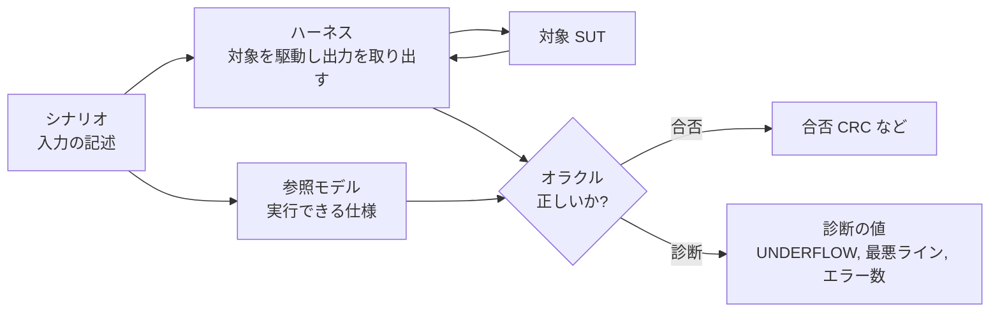
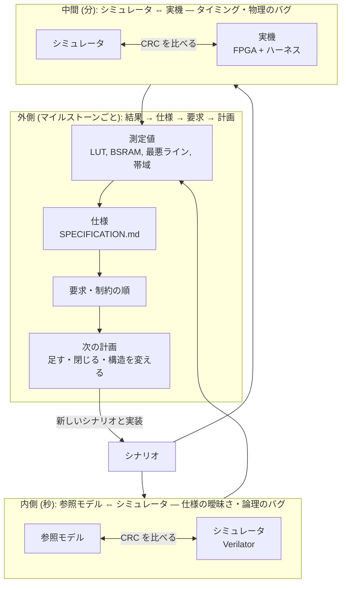
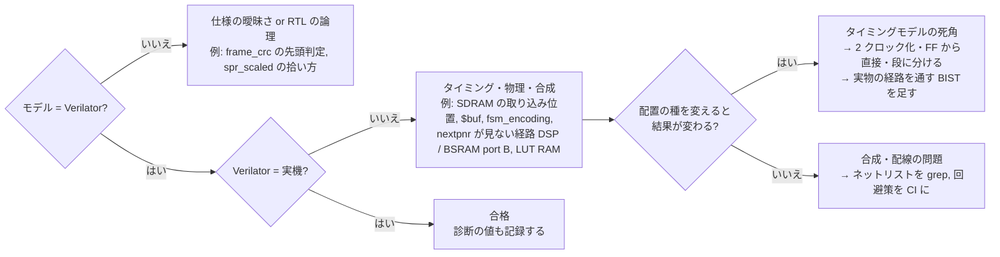
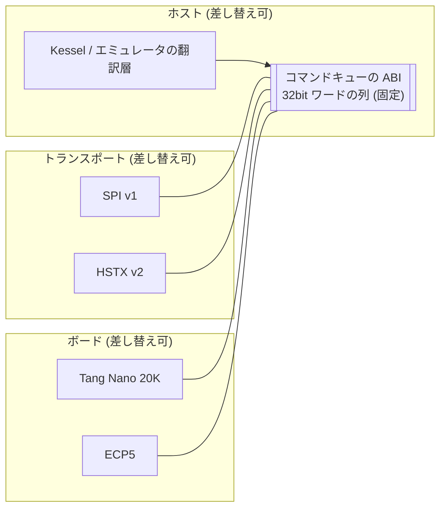

# ハーネス駆動の開発プロセス — LLM にハードウェア (と、それに似たもの) を作らせるためのガイドライン

tang-verilog (Tang Nano 20K の 2D GPU、M0 → E7 / K5a、2026 年 10 月) で実際に回った方法を、他のプロジェクトに持ち込めるように一般化したもの。
各項目に tang-verilog での具体例を付ける。

## 0. どういうときに効くか

この方法が効くのは、次の 3 つがそろう対象。

| 条件 | 意味 | tang-verilog では |
|---|---|---|
| **決定的** | 同じ入力から同じ結果が出る | 1 フレームはコマンド列から決定的に決まる |
| **圧縮できる結果** | 結果の正しさを小さな値 1 つに落とせる | フレームの CRC32 |
| **硬い予算** | 超えたら動かない、数えられる資源がある | LUT、BSRAM、1 ラインのクロック数、リンクの帯域 |

ソフトウェアの end-to-end テストが難しいのは、環境 (ネットワーク、時刻、外部サービス) が決定的でないから。
ハードウェアは逆に、物理的なハーネスさえあれば決定的な end-to-end テストが安く作れる。
同じ性質を持つソフトウェア (コンパイラ、シリアライザ、レンダラ、信号処理、プロトコルの実装) にもそのまま当てはまる。

## 用語: ハーネスとオラクル

この文書で使う言葉を、一般論として先に置く。

- **テストハーネス (harness)**: 対象 (SUT: System Under Test) を外から駆動し、結果を取り出すための道具一式。
  ソフトウェアならテストランナーとスタブ、ハードウェアなら「配線した別のマイコン + 計測器 + スクリプト」。
  ハーネスは対象に入力を入れ、出力を観測するだけで、**正しいかどうかは判断しない**
- **オラクル (oracle)**: 「その出力は正しいか」を判定するもの。期待値の表、別の実装 (参照実装)、性質の検査 (「クラッシュしない」「逆変換すると元に戻る」) など
- **参照モデル (reference model、golden model)**: オラクルの一種で、対象と同じ仕事をする別の、単純な実装。
  文書の仕様をプログラムにしたものなので「実行できる仕様」とも言える
- **差動テスト (differential testing)**: 同じ入力を複数の実装に入れて出力を比べる。どれが正しいかは言えないが、食い違えばどれかが間違っている。
  実装の数が 3 つ以上なら、食い違いの組み合わせで「どれが」まで絞れる
- **シナリオ**: ハーネスに流す入力の記述。再現できる形 (ここでは JSON のコマンド列) で保存し、全部の経路で同じものを使う



tang-verilog では、ハーネスが「RP2040-Zero + SPI + HDMI キャプチャ + `harness.py`」、オラクルが「参照モデル `gpu_model.py` と Verilator と実機の 3 つの差動テスト」、
合否が「フレームの CRC32」、シナリオが `scenarios/*.json`。

## 1. 3 重のループ



- 内側と中間は **同じテスト (シナリオ) を 3 つの経路で走らせて CRC を比べる**。食い違いの組み合わせで故障が切り分けられる:
  モデル ≠ シミュレータ なら仕様の曖昧さか RTL のバグ、シミュレータ ≠ 実機 ならタイミングか物理
- 外側は、**測定値を仕様に書き戻し、次の計画をその数値から決める**。見積もりではなく測定から外挿する


食い違いの組み合わせと、疑う場所:



tang-verilog で見つかったバグはきれいにこの 2 種類に分かれた。
内側: frame_crc のフレーム先頭判定、`spr_scaled` の拾い方の不一致。中間: SDRAM の取り込み位置、`$buf` のネットリスト、`fsm_encoding`。どれも 1 日で潰れた。

## 2. 原則

### 2.1 機能より先にオラクルを作る

最初のマイルストーンは「何かを作る」ではなく「正しさを判定する装置を作る」。
配線テスト、自己診断、メモリの BIST、結果のキャプチャ、CRC の読み出し、までが揃ってから機能に入る。

- tang-verilog: M0〜M4 (ハーネス、SPI、SDRAM の BIST、HDMI のキャプチャ、`FRAME_CRC`) が先。M5 以降の機能は全部この上に乗った
- 後からホスト側に広げるときも同じ: Kessel の VDP バックエンドは `gpu_model.py` をオラクルに、HSTX のリンクは「パケットのカウンタと CRC エラー数」をオラクルにする

### 2.2 仕様は実行できる形で持つ (参照モデル)

文書の仕様とは別に、同じことを計算する小さなプログラム (Python で十分) を持つ。これが「仕様の曖昧さ」を検出する装置になる。

- tang-verilog: `gpu_model.py`。シナリオ (JSON のコマンド列) を解釈して画像と CRC を出す。RTL はこれと一致しなければならない
- 「同じ絵を出す規則」 (線の端点、矩形の幅、負の座標、固定小数点の拾い方、パレットの丸め) は参照モデルに書くと決まる。文書だけでは決まらない

### 2.3 結果を 1 つの数に圧縮し、診断は別に出す

合否は 1 つの値 (CRC) で決める。原因を探るための値 (アンダーフロー、最悪ラインのクロック数、エラーカウンタ) は合否とは別に常に記録する。

- tang-verilog: `FRAME_CRC` が合否、`UNDERFLOW_COUNT` と `max_line_cycles` が診断。キャプチャは目視の代わりで合否には使わない
- 印付きフレーム (どのフレームの CRC かを明示する) がないと、ダブルバッファや 1 フレームの遅れで比較がずれる

### 2.4 予算を健全性の指標にして CI に出す

硬い予算 (資源、時間、帯域) は **正確・安い・単調** の 3 つを満たす珍しい指標。毎回の PR で測り、傾きを見る。

| 指標 | 性質 | 使い方 |
|---|---|---|
| LUT / ALU / DFF | 正確、安い、ほぼ単調 | 残りが 30% を切ったら構造を見直す。nextpnr の「LUT4」には ALU が使う LUT も入っている (yosys の LUT + ALU と一致。G5 のあとで確かめた)。配置は LUT が余っていても DFF と制御集合 (CE / リセットの組) で失敗する (G3、G5 のあと 6,800 前後) ので、DFF も毎回記録する |
| BSRAM | 正確、離散 (1 ブロック単位)、単調 | 残りが数個になったら、次に足すものを先に数える |
| 1 ラインのクロック数 (最悪) | シミュレータで正確に数えられる | 予算 (4,000) に対する残り。プロファイルごとの上限を表にする |
| リンクの帯域 (1 フレームに送れるワード数) | 計算できる | 設計を決める最初の制約 (SPI 8MHz は 16KB/フレーム → フレーム転送は不可能) |

- tang-verilog: 各 PR の本文と計画の「結果」に LUT / DFF / BSRAM / Fmax / 最悪ラインを必ず書いた。BSRAM が 39 → 40 → 44 と動く傾きを見て、
  E2.5 (順位タグ付きの作業ライン) を**壁に当たる前に**入れた。壁に当たってから直すと二度手間になるものを、傾きだけで先回りできる
- 制約の順 (BSRAM > 帯域 > ラインの時間 > LUT) を文書に書き、新しい機能はその順で評価する
- 制約の順は設計によって入れ替わる。VDP では BSRAM が先に詰まり、3D (G3) では DFF が先に詰まって BSRAM は余った。順が変わったら文書を直し、余った資源に寄せる (FF の表を BSRAM へ)

### 2.5 測定値を仕様に書き戻す

計画の文書には必ず「結果」の節を設け、測定値と、計画からずれた点とその理由を書く。次の計画はその数字から外挿する。

- tang-verilog: GPU_PLAN.md / EMU_GPU_PLAN.md / KESSEL_ON_VDP.md の各段階に「◯ の結果 ✅」。SPECIFICATION.md は結果から書き起こした
- 「E7 の LUT は見込みの 2 倍。理由はレジスタを 2 組持つこと…」のように、ずれの理由まで書くと次の見積もりの精度が上がる

### 2.6 作る側と見る側を分け、周期を変える

PR 単位で動く作り手には、横断的な傾向 (資源の軌道、別の層との不一致、予算の残り) が見えにくい。マイルストーンごとに別の視点で読む役を置く。

- レビューは文書 (`pre_M5_review.md`、`pre_E3_review.md`、`pre_E5_review.md`、`pre_K5_review.md`、`pre_G4_review.md`) にして、作り手が項目ごとに採る・退けるを決め、その理由を計画に書き残す。書き残したらレビューの文書は計画に畳んで消す
- 退けた理由が残ると、設計判断の記録になる (「`DRAW_TILEMAP` は E2 で不要、opcode は予約」)
- 見る側の役は LLM でも人でもよい。tang-verilog では作り手がエージェント、見る側が別のセッションの LLM と人だった

### 2.7 レビューは「制約と理由」を書き、「機構」は作り手に委ねる

最良の結果が出たのは、作り手がレビューの案を退けて別の機構を選んだとき。

| レビューの案 | 作り手が選んだもの | 結果 |
|---|---|---|
| 遠近の道路は `WAIT_LINE` + `REG_WRITE` を行ごとに流す | 行ごとの値を VRAM の表から読む | 1 フレーム 841 ワード 20.9fps → 12 ワード 60.1fps |
| レイヤごとのラインバッファ | 順位タグ付きの作業ライン 1 本 | BSRAM が増えない |
| 深さ 3 段のために RTL を変える | `bitmap_rank = 6` で既存の順位に乗せる | RTL の変更なし |

レビューに書くべきは「BSRAM は残り 7 個」「帯域は 16KB/フレーム」「同じ絵が出なければならない」という制約と、その理由。機構を指定すると、より良い案を潰す。

### 2.8 見積もりは桁合わせ、判断は測定

見積もりは当たらない (E7 の LUT は 2 倍、E2 の BSRAM は当たった)。ループの価値は予測の精度ではなく、測定が安いことにある。
見積もりは「入るか入らないか」の桁を合わせるために使い、構造の判断は測ってから。

### 2.9 外部のオラクルを取り込み続ける

参照モデルと実装を同じ主体 (同じ LLM) が書くと、同じ誤解を共有して「一致したが間違い」になる。それを抑えるのは、物理 (実機) と、外部の基準。

- tang-verilog: bsnes の Mode 7 の式 (`& ~63`、clip)、Kessel 側の `spr_scaled` の実装 (#107 で VDP に合わせた)、
  これから使う実ゲームの VRAM・レジスタのダンプ、SGDK の ROM
- 新しい機能ごとに「外部のどの基準と比べるか」を完了条件に入れる

### 2.10 オラクルの死角を文書に書く

CRC の一致は「この条件では正しい」であって、全部ではない。死角を知っていれば、エージェントが実装のバグと取り違えない。

- tang-verilog: キャプチャの `capture_min` (1〜2 ピクセルの縞で落ちる)、1 枚の基板・1 つの温度での PSDA の余裕 (2 段未満で fail)、
  シミュレータでは見えないネットリストの問題 (`$buf`、合成ログを grep する)
- **ツールチェーンのタイミングモデルの死角** (G3 で判明): nextpnr の Gowin のモデルは DSP の経路と真のデュアルポート BSRAM の B ポートのアドレスを見ず、桁上げの連鎖も楽観的。
  「シミュレータは通る、Fmax の報告は OK、実機だけピクセルが化け、化ける場所が配置の種で変わる」が症状。LUT RAM (`RAM16SDP4`) が実機で値を壊す問題も同じ種類
- 死角が分かったら、**その死角を通る BIST** を作って起動時と自己診断に入れる。SDRAM の `memtest` と同じ発想をロジックに向けたもの:
  既知の答えと比べ、結果を STATUS に出す。基板・温度・配置の種が変わっても「境界に近い」が数秒で分かる。
  **別に置いた試験用の回路は実物とは別の配置・配線になるので、実物の余裕は測れない**。実物の DSP と BSRAM を通す (固定の場面を描いて CRC を比べる、
  または試験の入力を実物のアドレス・データのレジスタの手前で切り替える。レジスタのあとに論理を挟むと「FF から直接」が崩れる)
- 死角に当たったときの完了条件は「複数の配置の種で、実機で複数回通る」に広げ、温度の掃引も加える。報告された Fmax だけでは完了にしない
- 死角は上流 (apicula / nextpnr) に最小の再現例つきで報告する。直れば回避策 (DSP に 2 クロック、など) が外せる

### 2.11 足すのではなく置き換える

機能が増えたら、不要になった計画を閉じる。閉じた理由と、残す互換性 (opcode の予約) を書く。

- tang-verilog: `DRAW_TILEMAP` (M8) はタイルレイヤ (E2) で不要 → M8 は `STRETCH_BLIT` に。OLED と ERROR / LED の配線は使わなかったのでハーネス v2 で廃止

### 2.12 境界を固定して、両側を差し替え可能にする

一番安定した境界 (ここでは 32bit ワードのコマンド列) を決め、その両側 (ホスト、トランスポート、ボード) を独立に差し替えられるようにする。




- tang-verilog: コマンドキューの ABI を挟んだので、ホストは RP2040-Zero → Pico 2 (RP2350)、トランスポートは SPI → HSTX、
  ボードは Tang Nano 20K → (必要なら) ECP5、を別々に替えられる。Kessel のスクリーンのポート群も同じ境界になった

### 2.13 マイルストーンは 1 日・1 PR、完了条件はテストの結果で書く

完了条件は「◯◯ができる」ではなく「シナリオ X がモデル = Verilator = 実機、前からのシナリオの CRC が変わらない、最悪ラインが N 以下、資源が M 以下」。
これならエージェントが自分で完了を判定できる。

- tang-verilog: 一番速いときで E2.5 → E3 → M9 → E4 が 1 日。テストが安いからで、重い (ハーネスのない) 部分に入ると遅くなる

### 2.14 エージェントへの引き継ぎを文書に持たせる

次のセッションのエージェントが読むものとして、「同じ絵を出す規則」「制約の順」「死角」「閉じた計画」「次の順番」を 1 か所にまとめる。
会話の文脈は残らないが、文書は残る。

## 3. マイルストーンの型 (チェックリスト)

```
1. 計画      何を足すか、どの制約に触れるか (資源・時間・帯域)、見積もり (桁)、完了条件 (テストの結果として)
2. 参照モデル 先に参照モデルとシナリオを書く。モデル同士で通ることを確かめる (ここで仕様の曖昧さが出る)
3. 実装      RTL / コード。シミュレータでシナリオを通す
4. 実機      同じシナリオを実機で。前からのシナリオも全部
5. 測定      資源、最悪ライン、帯域、診断の値。CI のログに残す
6. 結果      計画の文書に「結果」を書く: 測定値、計画からのずれと理由、閉じた項目
7. レビュー   (マイルストーンのまとまりごとに) 横断的な傾向を見る。制約と理由を書く。作り手が採る・退けるを決めて記録する
```


## 4. 指標の対応表 (他に持ち込むとき)

| 対象 | オラクル (合否) | 診断 | 予算 (健全性) |
|---|---|---|---|
| FPGA (tang-verilog) | フレームの CRC (モデル = シミュレータ = 実機) | UNDERFLOW、最悪ラインのクロック、エラーカウンタ | LUT、BSRAM、Fmax、帯域 |
| ホストのファームウェア (RP2350) | 送ったコマンド列のハッシュ、`gpu_model.py` との一致 | READY 待ちの時間、PSRAM 待ちの割合、フレーム落ち | 1 フレームの送信ワード数、CPU 時間、RAM |
| リンク (HSTX) | パケットのカウンタ、CRC エラー 0 | 再同期の回数、FIFO の最大深さ | 帯域の使用率 |
| ゲームエンジンのバックエンド (Kessel) | 参照ラスタライザと VDP バックエンドの画像の一致 | スプライト予算の超過、コマンド数 | 1 フレームのコマンド数、VRAM の使用量 |
| コンパイラ / シリアライザ | リファレンス実装との出力の一致 | 警告、到達しないパス | コード量、コンパイル時間、バイナリの大きさ |
| 信号処理・レンダラ | 固定小数点の参照モデルとのビット一致 | 飽和の回数、精度のずれ | 演算量、メモリ |

## 5. アンチパターン

- **機能を先に作る**: オラクルがないまま機能を積むと、後で「どこが壊れているか」が分からなくなる
- **結果を数字なしで書く**: 「動いた」だけでは次の計画が立たない。資源・時間・帯域の数字を毎回
- **見積もりで構造を決める**: 見積もりは桁合わせ。構造の判断は測ってから
- **レビューで機構を指定する**: 制約と理由を書く。機構は作り手が選ぶ
- **参照モデルと実装を同じ理解で書いて満足する**: 外部の基準 (実機、他の実装、実データ) を定期的に当てる
- **オラクルの死角を知らずに実装を疑う**: 死角は文書に書く
- **ツールの報告 (Fmax、資源) を実機の代わりにする**: 報告は実機で確かめて初めて信じる。種を変えて結果が変わるなら、実装ではなくツールのモデルを疑う
- **閉じない計画**: 不要になった項目は理由つきで閉じる
- **境界を動かす**: ABI を頻繁に変えると、両側の差し替えが効かなくなる

## 6. tang-verilog の成果物の役割 (参考)

| ファイル | 役割 |
|---|---|
| `harness/` (ファームウェア、`harness.py`、`pins.json`、KiCad) | オラクルの物理的な部分。配線テスト、自己診断、BIST、キャプチャ、CRC の読み出し |
| `tools/gpu_model.py`、`scenarios/*.json` | 実行できる仕様とテスト。3 つの経路で同じものを走らせる |
| `sim/` (Verilator、`tb_*`) | 内側のループ。最悪ラインのクロック数もここで数える |
| `docs/SPECIFICATION.md` | 測定から書き起こした仕様。同じ絵を出す規則、プロファイルごとの予算 |
| `docs/GPU_PLAN.md`、`EMU_GPU_PLAN.md`、`KESSEL_ON_VDP.md` | 計画と「結果」。閉じた項目と理由 |
| `docs/pre_*_review.md` (後に計画に畳み込み) | 見る側の文書。採る・退けるの記録 |
| CI | 3 経路のテスト、資源と最悪ラインの記録、`$buf` の grep、予算の閾値 |
