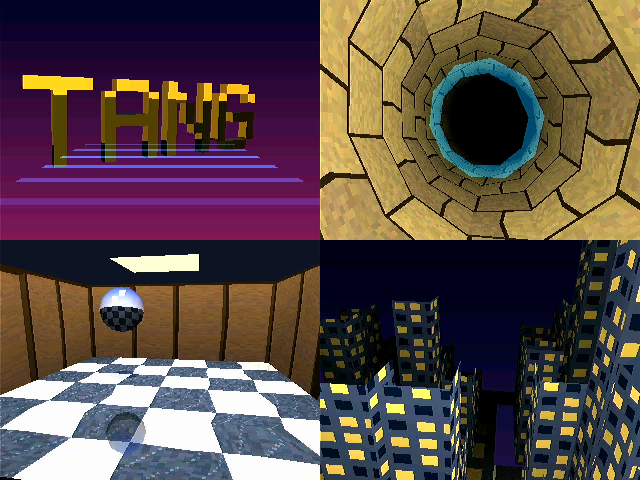

# 提案: Tang Nano 20K で PS1 級の 3D GPU (タイルベース、VDP を外した別のビットストリーム)

VDP (E7 / K5a まで) を外し、同じ基板・同じハーネス・同じコマンドキューの ABI の上に、**PowerVR 流のタイルベース・遅延レンダリング (TBDR)** の三角形ラスタライザを載せる。
目的は 2 つ。PS1 級 (320x240、Gouraud、アフィンのテクスチャ、半透明) の 3D がどこまで出るかを**測定で**知ること、
そして ECP5-25F で VDP と同居できるのか、85F が要るのかを、見積もりではなく数字で決めること。
方法は [DEVELOPMENT_PROCESS.md](DEVELOPMENT_PROCESS.md) のまま。

## 0. 結論 (見込み)

| | 見込み | 根拠 |
|---|---|---|
| 制約 | **SDRAM の帯域ではなく、ラスタライザのクロックが律速になる**。ただし効くのは被覆ピクセルだけでなく、(三角形, タイル) の組ごとの固定費と SDRAM のランダムアクセスの回数 | 2 章。TBDR で外部メモリのバイト数は 1/4 程度になる |
| 1 フレームに塗れる量 (被覆ピクセル、320x240、60fps) | 大きい三角形なら約 3〜5 画面分 (1 px/クロック、2 パス、外接矩形の半分は空振り)。小さい三角形が多いと組の固定費が律速 | 2.3 節の速さのモデル: `クロック ≈ 2 x (外接矩形 ∩ タイルのピクセル) + 2 x 組の数 x 40〜60`。G2 で項ごとに測る |
| テクスチャの取り出し | **見えるピクセルだけ** (重ね描きの分が消える) | 遅延テクスチャリング (3.3 節) |
| Z バッファと半透明 | 全部オンチップ (BSRAM)。SDRAM の Z バッファはない | タイルバッファ (3.2 節) |
| 三角形の数 | 1 フレーム 4,096 個 (パラメータバッファの上限、パラメータで変えられる) | 3.1 節 |
| 遅延 | 1 フレーム (ビニングと描画を重ねる) | PowerVR と同じ |
| 資源 | LUT 13,000〜15,000 (63〜72%)、BSRAM 約 12〜15 / 46、DFF 約 4,000 | 6 章 (残す 2D の GPU を実績から見直した) |
| 残るもの | ハーネス、SPI / HSTX の受信、SDRAM 制御とアービタ、表示、CRC、DVI / LCD、参照モデルの骨格、CI | VDP だけが抜ける |

即時モード (三角形をそのままフレームバッファに描く) も G1 の基準として残し、同じシナリオで **即時 vs TBDR** を測って TBDR の効き目を数字で出す。

## 1. 何を作るか (PS1 級の定義)

PS1 の GPU と**同じ種類**のことができる、という意味。PS1 と同じ結果を出すことは目標にしない。

| 機能 | 入れる | 備考 |
|---|---|---|
| 三角形 (単色 / Gouraud) | ◯ | 四角形はホストが 2 つに割る |
| テクスチャ (アフィン、4 / 8 / 16bpp、CLUT) | ◯ | PS1 もアフィン。遠近補正は後 |
| テクスチャの色の変調 | ◯ | 8bit x 8bit の乗算 3 個 (LUT で組む) |
| 半透明 (加算、平均、減算、1/4 加算) | ◯ | タイルの中で、不透明の後に投入順で描く。オンチップなので安い |
| Z バッファ (16bit) | ◯ (常にオンチップ) | PS1 にはないが、タイルバッファにあるので無料同然 |
| 隠面消去 (遅延テクスチャリング) | ◯ | PowerVR の ISP / TSP に相当 (3.3 節) |
| 線、矩形 (スプライト) | ◯ | 既存の `DRAW_LINE` `FILL_RECT` `BLIT` (即時。タイルのパスの後に描く) |
| クリップ矩形 | ◯ | |
| 順序に依存しない半透明 (PowerVR の per-pixel ソート)、モディファイアボリューム | ✗ | 大きすぎる。半透明は投入順 |
| 頂点変換・照明・クリッピング | ✗ | ホスト (RP2350)。PS1 も GTE がやっていた |

出力は今のまま 320x240 を 2 倍で 640x480 (HDMI) / LCD。

## 2. 帯域の試算 (なぜタイルベースか)

SDRAM 32bit 63MHz = 252MB/s、実効 (行の切り替えとリフレッシュ、表示 9.2MB/s を引いて) **約 160MB/s**。

### 即時モード (G1 の基準)

| 1 ピクセルあたり | B |
|---|---|
| 色の書き込み | 2 |
| 半透明の読み出し | +2 |
| Z の読み書き | +4 |
| テクスチャ (キャッシュ込み、**重ね描きの分も**) | +1〜2 |

テクスチャ + Z で 7〜8B/px → 20Mpx/s → 1 フレーム 4〜5 画面分。帯域が律速。

### TBDR

| 1 フレームあたり (2,000 三角形、重ね描き 4) | KB |
|---|---|
| 形状とセットアップ結果の書き込み (2,000 x 96B) | 192 |
| タイルリストの書き込み (2,000 x 2 タイル x 2B) | 8 |
| タイルのパスでの形状の読み出し (タイルごとに、触れる三角形の分) | 384 |
| テクスチャ (**見えるピクセルだけ**、76,800 x 2B x 1.5) | 230 |
| 色の書き出し (タイルから、バースト) | 150 |
| 合計 | **約 960KB/フレーム = 58MB/s** (実効 160MB/s の 1/3 強) |

Z・半透明・重ね描きが SDRAM に出ないので、律速がラスタライザのクロックに移る。
(形状の読み出し 384KB は、ISP と TSP で形状を 1 回だけ読む前提。読み直すなら 768KB。3.3 節)

### 2.1 ランダムアクセスはバイトではなく回数で数える

今の `sdram_ctrl` は要求ごとに行を開いて閉じる (ACTIVE … オートプリチャージ)。バーストは速い (`CLEAR` の実測 約 219MB/s) が、
1 ワードのアクセスは 8〜10 クロック + アービタの分かかる。TBDR でランダムになるのは **タイルリストの追加 (組ごとに 1 回)** と
**テクスチャのミス** の 2 つで、どちらも「回数 x 10 クロック」で見積もる。

- タイルリストの追加は、タイルごとの書き込みの寄せ集め (オンチップで 80 タイル x 8 項目 = 1.3KB) を置き、溜まったらバーストで書く。1 項目ずつ書くと 2,000 三角形 x 2 タイルで約 40,000 クロック
- テクスチャのミスは 1 行 (8 ワード) のバーストで埋める。ミス 1 回 約 20 クロック。ヒット率で決まる (G3 で測る)

### 2.2 SPI の帯域 (実測)

ハーネス v1 (USB → RP2040 → SPI) の実測は約 180KB/s = **1 フレーム約 3KB** (E7 で、1 フレーム 841 ワードのコマンドが 20.9fps)。
G5 のあと、ブリッジ v3 の `stream` (空きの確かめをブリッジでする) で **約 764KB/s** (USB のフルスピードの CDC が律速。HARNESS.md)。
`TRI` 10 ワードなら 60fps で約 75 個。G1〜G4 の確かめは印付きフレームで足りるが、G5 の「60fps で何三角形」は HSTX (新しいハーネス) か、
RP2350 の上でコマンドを作るホストが前提になる。

### 2.3 速さのモデル

タイルのパスのクロックは、被覆ピクセルではなく次で決まる:

```
  クロック ≈ 2 x Σ(外接矩形 ∩ タイルのピクセル)            ISP と TSP の 2 回の走査。三角形の外のピクセルも走査する (約半分)
           + 2 x 組の数 x (40〜60)                          組 = (三角形, タイル)。リストの読み出し、形状の取り出しの待ち、パイプラインの空け
           + テクスチャのミスの回数 x 約 20
           + タイルの数 x 約 830                            書き出し (行を開く 32 回のバースト)。色バッファが 2 組なので次のタイルと重なる
```

大きい三角形の場面 (数百個) なら第 1 項が主で 1 フレーム 3〜5 画面分、小さい三角形が多い場面 (2,000 個、平均 2 タイル) なら第 2 項だけで
約 0.4M クロック (1 フレームの 4 割) になる。G2 でこの項ごとに測り、モデルを実測で置き換える。

## 3. 設計

### 3.1 メモリの配置 (SDRAM 8MiB)

| アドレス | 大きさ | 用途 |
|---|---|---|
| `0x000000` | 512KiB | フレームバッファ 2 面 (RGB565、1 ライン 1KiB)。今と同じ。表示はそのまま |
| `0x080000` | 1MiB | パラメータバッファ A: 形状 + セットアップ結果 (4,096 三角形 x 96B = 384KiB) + タイルリスト (80 タイル x 4KiB、1 項目 2B、最大 2,048 個/タイル) |
| `0x180000` | 1MiB | パラメータバッファ B (ビニングと描画を重ねるための 2 面目) |
| `0x280000` | 1MiB | テクスチャ VRAM (`UPLOAD` で書く) |
| `0x380000`〜 | 4.5MiB | 予備 |

SDRAM の Z バッファはない (G1 の即時モードの基準測定のときだけ、予備の領域に置く)。

### 3.2 タイルとタイルバッファ

- タイル 32 x 32。320 x 240 は 10 x 7.5 なので、一番下の列は半分 (クリップ)。80 タイル
- タイルバッファ (BSRAM): 色 1,024 x 16bit (1 個)、Z 1,024 x 16bit (1 個)、タグ 1,024 x 12bit (三角形番号、1 個)。
  色は 2 組 (描画と書き出しを重ねる) で合計 **4 個**
- 書き出し: 32 行 x 64B = 16 ワードのバースト x 32。今の `sdram_ctrl` のバーストと 1 ライン 1KiB の配置のまま

### 3.3 フレームの流れ (PowerVR の TA → ISP → TSP に相当)

```
  ホスト → コマンド FIFO (今のまま)
    ↓ BEGIN_SCENE
  [ビニング: TA]   TRI ごとに: セットアップ (3.4) → 形状と係数をパラメータバッファに書く (96B のバースト)、
                 外接矩形 → 触れるタイルの範囲、各タイルのリストに三角形番号を追加 (1 ワードの書き込み)
    ↓ END_SCENE    (次のフレームのビニングは、もう片方のパラメータバッファで並行)
  [タイルのパス]    80 タイルを順に:
    1. リストと形状を読む (タイルに触れる三角形ごとに 96B、投入順)
    2. ISP (隠面消去): 不透明の三角形を順にラスタライズ。Z だけ補間し、Z テストに通ったピクセルに
       Z と三角形番号 (タグ) を書く。テクスチャも色も触らない。1 px / クロック。
       Z を 1 回でも通した三角形の形状は、オンチップの小さい表 (64 個) に残す (TSP で SDRAM から読み直さない。溢れたら読み直す)
    3. TSP (シェーディング): ISP で残した不透明の三角形を再びラスタライズ。**タグがその三角形のピクセルだけ**
       色を補間し、テクスチャを引き、変調して色バッファに書く。他のピクセルは飛ばす (DDA は進める)
    4. 半透明の三角形を投入順にラスタライズ。Z テスト (書かない)、色バッファと混ぜる
    5. 色バッファをフレームバッファにバースト書き出し (もう 1 組の色バッファで次のタイルを始める)
    ↓
  [即時の 2D] DRAW_LINE / FILL_RECT / BLIT (HUD など) をフレームバッファに
    ↓ SWAP
```

ISP と TSP の 2 回のラスタライズは、どちらもオンチップで 1 px / クロック。被覆ピクセル数の 2 倍のクロックがかかるが、
テクスチャの取り出し (SDRAM のランダムアクセス) は見えるピクセルに対して 1 回だけになる。

- **Z とタグの消去**: タイルごとに 1,024 個を消すと 1 フレーム約 82,000 クロック。Z は 1 組なので、1,024bit の「このタイルでまだ触っていない」印
  (フリップフロップか分散 RAM) を持ち、初めて触ったピクセルは Z を最大とみなす。印はタイルの始めに 1 クロックで消える
- **Z の読み書きの重なり**: 1 px / クロックの「読む → 比べる → 書く」は 2〜3 クロックの遅れがあるので、次の (小さい) 三角形が書き終わっていない
  ピクセルを読むことがある。書き込み中のアドレスと比べて前の値を回す (フォワーディング) か、三角形のあいだに 3 クロック空ける
- **即時の 2D とシーンの順番**: タイルのパスはビニングと重なって 1 フレーム遅れて動くので、`END_SCENE` のあとの `DRAW_LINE` `FILL_RECT` `BLIT`
  をコマンドの順に実行すると、そのフレームのタイルの書き出しより先に描かれて消える。そこで **シーンの中の 2D のコマンドはパラメータバッファに記録し、
  そのフレームのタイルのパスが終わったあとに再生する** (ビニングは止めない)。`SWAP` もタイルのパスと 2D の再生が終わるまで待つ。
  (ほかの案: 矩形と線もビニングしてタイルの中で描く、HUD 用の重ね合わせのレイヤを持つ。どちらも大きいので、まず記録と再生)

### 3.4 ラスタライザの核 (即時モードと共通)

- 頂点の範囲 (ホストが守る): x, y は **-512〜+831** (画面の外に 512 ピクセルのガードバンド)。これより外にはみ出す三角形はホストがクリップする。
  この範囲で、12.4 の頂点からのエッジ関数は 28bit に収まる
- セットアップ: エッジ関数の係数、面積の逆数 (除算 1 回)、属性 (z, u, v, r, g, b) の勾配。シフトと加算の直列の乗算器 1 個と除算器 1 個で 100〜200 クロック/三角形
  (G0 で DSP が使えると分かれば乗算はそちら)。
  **セットアップはビニングのときに 1 回だけ**行い、結果をパラメータバッファに置く。タイルのパスでは読むだけなので、三角形が小さいときのセットアップの律速がタイル側に出ない
- **タイルの角の値**: セットアップは三角形の外接矩形の左上 (原点) でのエッジ関数 3 本と属性 6 個の値と勾配 (A, B) を置く。
  タイル (tx, ty) の角の値は `値 + (tx x 32 - 原点の x) x A + (ty x 32 - 原点の y) x B` だが、原点をタイルの格子に揃えておけば
  `値 + Δtx x 32 x A + Δty x 32 x B` (Δ は 4bit) で、**乗算器なしのシフトと加算** で組ごとに数クロック。
  直列の乗算器 (1 回 17 クロック) で 9 個 x 2 回を組ごとに計算すると、組あたり約 300 クロックで 1 フレームに収まらない
- 走査: 三角形の外接矩形とタイルの交差の中を走査線順に。エッジ関数 3 本の加算、属性の DDA
- 固定小数点と規則 (「同じ絵を出す規則」、参照モデルと同じ): 頂点 x, y は符号付き 12.4、z 16bit、u, v 8.8、rgb 8bit。エッジ関数 28bit、上左の規則、丸めは切り捨てに統一。
  **1 / 面積は正規化した形** (18bit の仮数 + 5bit のシフト)。面積は 1/256 ピクセル² の単位で最大 約 2^25 になり、16.16 では大きい三角形で 0 に潰れる。
  勾配 = (Δ属性 x エッジの係数) x 仮数 >> シフト
  Z テストは「小さいとき」 (同じ値は先に投入した方が勝つ)。**即時モードと TBDR で同じ結果になる**のは、この規則が同じだから

### 3.5 テクスチャ (TSP)

- 直接写像のキャッシュ 32 行 x 32B (BSRAM 1 個)、CLUT 256 x 16bit (1 個)
- TBDR ではタイルの中でテクスチャの局所性が高い (同じ三角形の隣のピクセル) のでヒット率はさらに上がる見込み。測る
- **CLUT の読み直し**: TSP はタイルごとに三角形を投入順にたどるので、タイルの中でテクスチャ (CLUT) が変わるたびに CLUT を読み直す (最大 128 ワード)。
  これが 80 タイルぶんくり返される。CLUT を 4 組持ち、基底のアドレスで引く (同じ基底なら読み直さない)。タイルの中の切り替えの回数を G3 で測る

### 3.6 コマンド (今の ABI のまま、32bit ワードの列)

| opcode | 名前 | 語数 | 内容 |
|---|---|---|---|
| 既存 | `CLEAR` `FILL_RECT` `DRAW_LINE` `BLIT` `UPLOAD` `SWAP` `WAIT_VBLANK` `REG_WRITE` `FRAME_CRC` | | そのまま |
| `0x20` | `TRI` | 4〜10 | フラグ (単色 / Gouraud / テクスチャ / 半透明の種類) + 頂点 3 つ `{y(16), x(16)}`、Gouraud なら `{rgb(24)}`、テクスチャなら `{v(16), u(16)}`、`{z(16)}` |
| `0x21` | `SET_TEX` | 2 | テクスチャページの基底、形式、幅、CLUT の基底 (TRI の形状と一緒に記録される) |
| `0x22` | `SET_CLIP` | 2 | 描画領域の矩形 |
| `0x23` | `SET_BLEND` | 1 | 半透明の式 |
| `0x25` | `BEGIN_SCENE` | 1 | ビニングを始める (パラメータバッファを切り替える) |
| `0x26` | `END_SCENE` | 1 | ビニングを終え、タイルのパスを始める。終わると `STATUS` に出る |
| `0x27` | `MODE` | 1 | 0 即時 (G1 の基準)、1 TBDR |

`TRI` のコマンド列は即時でも TBDR でも同じ。ホストもシナリオも変わらず、CRC も同じになる。ただし **同じ CRC になるのはホストが次の順を守るとき**:

- シーンの中では **不透明の三角形を全部送ってから半透明** (TBDR はタイルの中で不透明を先に描くので。半透明は Z を書かないので、即時モードで
  半透明の後ろに不透明を送ると、不透明が半透明を混ぜた色を上書きして結果が変わる)
- 2D のコマンド (`DRAW_LINE` `FILL_RECT` `BLIT`) は、そのシーンの三角形のあと (3.3 節の記録と再生)
- 不透明どうしは Z テストが「小さいとき」なので、同じ Z は先に送った方が勝つ (どちらのモードでも同じ)

1 三角形 最大 10 ワード。1 フレーム 2,000 個で 80KB → HSTX (620KiB/フレーム) で本番。SPI はハーネス v1 の実測で 1 フレーム約 3KB (約 75 個。2.2 節)。

## 4. 検証 (今の方法のまま)

- `gpu_model.py` に 3.4 の規則どおりのラスタライザ (ピクセル単位、固定小数点を同じ桁で)。**モデルは即時でよい** (TBDR は結果が同じになるはずなので、違えば TBDR のバグ)
- シナリオ (即時と TBDR の両方で走らせ、CRC が一致することも完了条件):
  - 単色の三角形 1 つ、向きと頂点の順の全組み合わせ、画面の外、退化、1 ピクセル、**タイルの境界をまたぐもの**
  - 共有する辺を持つ 2 つで隙間も重なりもない (`FILL_RECT` と同じ CRC)
  - Gouraud、テクスチャ (4 / 8 / 16bpp、ラップ)、変調、半透明 4 式、クリップ、Z (手前・奥・同じ値 → 投入順)
  - 乱数の三角形 1,000 個 (種を固定)、タイルリストが溢れる数 (上限の挙動)
  - 回る立方体 (ホストが変換、印付きフレーム)
  - 順の規則: 不透明 → 半透明 → 2D の順なら即時と TBDR で同じ CRC。逆の順のシナリオは「違ってよい」ものとしてモデルが即時の結果を出す
- `tb_rasterizer`: 乱数の三角形で参照の式とピクセル単位に比べる。`tb_tile`: 1 タイルに ISP → TSP → 書き出しで即時と同じ
- 実機: selftest、前からの 2D のシナリオの CRC が変わらないこと
- **測るもの** (この提案の目的): 被覆ピクセル/フレーム、三角形/秒、SDRAM の使用率 (即時 vs TBDR)、テクスチャのヒット率とミスで止まったクロック、タイルのパスのクロック数の内訳 (ISP / TSP / 半透明 / 書き出し)、資源

## 5. 段階

| # | 内容 | 完了条件 |
|---|---|---|
| G0 ✅ | `MODE=gpu3d` の骨格 (VDP を抜いて 2D のコマンドだけ)、メモリ配置。**DSP (Gowin の乗算器) がオープンソースのツールで使えるかを確かめる** | 2D のシナリオが VDP モードと同じ CRC。資源の基準値。DSP の推論・配置配線・実機での乗算の結果 |
| G1 ✅ | 即時モード: 単色 + Gouraud の三角形、セットアップ、走査、上左の規則、クリップ、Z (SDRAM)。参照モデル | 三角形のシナリオがモデル = Verilator = 実機。塗り速度と SDRAM の使用率 (**基準**) |
| G2 ✅ | TBDR: ビニング、パラメータバッファ、タイルバッファ、ISP / TSP (単色 + Gouraud)、書き出し、`BEGIN/END_SCENE` | G1 のシナリオが TBDR で同じ CRC。被覆ピクセル/フレームと SDRAM の使用率 (即時と比べる) |
| G3 ✅ | テクスチャ (キャッシュ、CLUT、変調)。即時と TBDR の両方 | テクスチャのシナリオ。ヒット率と、取り出し回数が「見えるピクセル」に近いこと |
| G4 ✅ | 半透明 (タイルの中、投入順)。即時側は読み出しつき | 半透明のシナリオ。最悪の組み合わせの数字 |
| G5 ✅ | 回る立方体 → PS1 風の場面 (数百〜2,000 三角形)。ホストは Python (SPI) → RP2350 (HSTX)。**60fps の測定は HSTX (E5a / 新しいハーネス) が前提** | 60fps で何三角形・何画面分まで出るかの表、即時 vs TBDR |
| G6 | 判断 | 測定値から: Tang Nano 20K で十分か、ECP5-25F で VDP と同居できるか、85F が要るか |

G1 を飛ばして G2 から始めてもよいが、即時の基準があると「TBDR が何を何倍にしたか」が数字で残る。
G1 の Z (SDRAM) は TBDR では使わないので、基準の測定が済んだら外してよい。

### G0 の結果 ✅

- **ビットストリーム**: `make bitstream TARGET=gpu3d` (成果物は `build/gpu3d/`)。トップは HDMI と同じ `rtl/gowin/top.sv` の `GPU3D = 1`
  (`read_slang -G GPU3D=1`)。`make scenario TARGET=gpu3d` で Verilator も同じ構成になる。`VERSION` (0x7F) の bit7 が 1 (0x81) で、ホストから見分けられる
- **VDP を外したもの**: line_compositor (面・スプライト・8bpp の表示・ライトマップ・Mode 7・VRAM 64KiB)、音。代わりに
  [`rtl/gpu3d/fb_line.sv`](../rtl/gpu3d/fb_line.sv) (ビットマップ RGB565 + 背景色・透過色だけの表示。ラインの頼み方・`WAIT_LINE`・`SWAP`・印・`UNDERFLOW` は
  line_compositor と同じ)。gpu.sv はそのまま (面などのレジスタの出力はつながず、合成で消える)。2D のコマンドは全部残っている
- **2D のシナリオ**: `m5_basic` `m5_stress` `m5_upload` `m6_lines` `m7_blit` `m7_frames` `e1_raster` (ラインごとの背景色・透過色) が
  モデル = Verilator = 実機で、VDP のビットストリームと同じ CRC (キャプチャも 99〜100%)。`fps m7_fps` 60.1。selftest 通過。
  1 ラインの合成は 352 クロック (VDP は 513)
- **DSP**: yosys の `synth_gowin` は乗算を DSP に置く (`-nodsp` でなければ)。VDP でも E7 のライトマップと霧の乗算 9 個がすでに `MULT9X9` に置かれていて、
  符号なしの乗算として実機で CRC が一致している。G0 で 18 x 18 を [`rtl/gpu3d/mul_probe.sv`](../rtl/gpu3d/mul_probe.sv)
  (`harness.py mulprobe`、0x50 の窓) で確かめた:
  - **符号付きの乗算は実機で間違う**。yosys は `MULT18X18` の `ASIGN` / `BSIGN` を VCC につなぎ、nextpnr も配線しているが、実機は符号なしで掛けた値を出す
    (例: 1 x -1 が 262,143)。3,006 組のうち、どちらかが負の組は全部違い、両方正の組は全部合う
  - **回避: 符号なしの DSP + 符号の補正** (`A * B = Au * Bu - (A < 0 ? Bu << 18 : 0) - (B < 0 ? Au << 18 : 0)`、36bit で回る)。3,006 組で全部合う。
    補正は 18bit の引き算 2 つ (LUT 約 60)。3D の乗算 (セットアップ・変調) はこの形で DSP を使う。上流 (nextpnr-himbaechel / apicula) に報告する
- **メモリ配置**: 3.1 節のまま。G0 では 2D の面 (先頭 512KiB) だけ使う
- 資源 (HDMI、nextpnr):

  | | VDP (E7) | gpu3d (G0、mul_probe なし) | gpu3d (G0、mul_probe 込み) |
  |---|---|---|---|
  | LUT4 | 10,407 | 7,189 (35%) | 7,419 (36%) |
  | DFF | 4,776 | 2,630 | 2,810 |
  | BSRAM | 44 / 46 | 5 / 46 | 5 / 46 |
  | DSP | MULT9X9 9 | 0 | MULT18X18 2 |
  | Fmax `clk_sys` | 88.5MHz | 104.5MHz | 89.2MHz |

  残すものは見込み (5,000〜6,500) より多い 7,189。2D の GPU (8bpp・BLIT4・`STRETCH_BLIT` 込み) が大きい。3D の分 (6 章、約 7,500〜8,500) を足すと
  約 14,700〜15,700 (71〜76%)。G1 の前に、2D の GPU から `STRETCH_BLIT` と 8bpp を外したときの資源を測るか、3D の分の DSP で LUT を減らす

### G1 の結果 ✅

- **作ったもの** (`rtl/gpu3d/`):
  - `smul36x18.sv`: 符号付き 36 x 18 の乗算 (DSP は符号なしの 18 x 18 を 2 つ、符号は LUT で直す。G0 の回避)。1 クロックに 1 つ、3 クロック後に結果
  - `tri_setup.sv`: セットアップ。面積 → 向きを揃える → 外接矩形 → 辺の値と属性の分子 (22 回の乗算)、並行して面積の逆数の仮数 (17 回の引き戻し除算) →
    増分 (8 回、`(N x m) >> n` を 32bit で飽和) → 左上の値 (8 回)。**最大 62 クロック**
  - `tri_engine.sv`: 即時の描画。外接矩形を 1 行ずつ: Z の行をバーストで読む → 1 クロックに 1 ピクセル (辺の判定、Gouraud、Z) → 通った範囲を
    色と Z にマスク付きのバーストで書く。SDRAM はアービタの d (3D GPU では音の代わり)
  - gpu.sv (`GPU3D = 1`): `TRI` (0x20) のワード列を tri_engine に渡して終わるまで待つ、`CLEAR_Z` (0x24)、`REG_WRITE 27 Z_BASE`。
    仕様は SPECIFICATION.md の 14 章、計算の規則は [`tools/harness/raster.py`](../tools/harness/raster.py) が正
- **参照モデル**: `raster.py` (セットアップと走査の整数の計算) を `gpu_model.py` が使う。上左の規則は、矩形を 2 つに割った三角形が `FILL_RECT` と同じピクセル
  (200 通り)、ずらした格子の網 (向きも混ぜる) で全ピクセルがちょうど 1 回 (50 通り) をモデルで確かめた
- **検証**:
  - `tb_smul36x18` (端の値と乱数 2,008 個)、`tb_tri_setup` (乱数の三角形 1,507 個の全出力を raster.py と同じ式の参照と比べる。ガードバンドの端、細長いもの、
    面積 0、クリップの外)
  - シナリオ `scenarios/gpu3d/g1_tri.json` (7 つ: 単色の頂点の順 6 通り・画面の外・面積 0・1 ピクセル・細長い / 辺の共有 (`FILL_RECT` と同じことをモデルで assert) と扇 /
    Gouraud + Z (交わる 2 枚、同じ Z は先が勝つ) / クリップ / 乱数の三角形 1,000 個 / 立方体 2 つの角度): **モデル = Verilator = 実機**
  - 2D のシナリオ (G0 の 7 個 + `m5_spans`) は 3D GPU のビットストリームでも同じ CRC。表示の読み出しの最大待ちは 350 クロックのまま
  - 実機: `fps g1_fps` (回る立方体 12 三角形) 59.9、`fps g1_fill_fps` (画面全体の Gouraud + Z を 2 枚) 59.9、4 枚 30.0、6 枚 20.0
- **見つけて直した不具合**:
  - **gpu.sv のバーストの終わりの判断 (M5 からある)**: `sdram_ctrl` の ack は最後の `wnext` の次のクロックに出るので、64 ワードのバーストのあと残りが
    ちょうど 1 ワードの行 (65 / 129 ワードの `FILL_RECT`・`BLIT`・`STRETCH_BLIT`) は最後のワードを書かずに終わっていた。バーストの最後のワード
    (`seg_last`) で判断するように直し、`tb_gpu` とシナリオ `m5_spans` (VDP でも 3D GPU でも) を足した。今までのシナリオにはその幅がなかった
  - **LUT の RAM は実機で値が化ける**: `tri_setup` の `nx` / `ny` (4 x 36bit) が `RAM16SDP4` に置かれ、Verilator では合うのに実機の三角形が崩れた。
    `RAM16SDP4` を禁止するとすべて合い、許すと (タイミングに余裕があっても) 7 個とも外れる。Makefile の `synth_gowin` に `-nolutram` を足した
    (VDP はもともと LUT の RAM を使っていない)。CLAUDE.md の RTL の方針にも書いた
  - 外接矩形の計算を 1 クロックでしていて `clk_sys` の Fmax が 67MHz (目標 63MHz) しかなかったので、3 クロックに分けた (92.9MHz)
- **測定 (即時モードの基準、Verilator の数え。実機の fps と合う)**:

  | 場面 | 描いたピクセル | クロック | 1 ピクセル (または 1 三角形) あたり | 1 フレーム (1.05M クロック) で |
  |---|---|---|---|---|
  | 画面全体の単色 x 8 枚 (Z なし) | 614,400 | 1.62M | 2.6 クロック (走査 1.3 / ピクセル、外接矩形の半分は外) | 約 5 画面 |
  | 画面全体の Gouraud + Z x 8 枚 | 614,400 | 2.76M | 4.5 クロック | 約 3 画面 |
  | 10 ピクセル角の Gouraud + Z x 2,000 | 71,768 | 1.08M | **540 クロック / 三角形** | 約 1,950 三角形 |

  SDRAM のワードは Gouraud + Z で 1 ピクセルあたり 2.0 (Z の読み 0.5 + 色 0.5 + Z 0.5、外接矩形の外の分を含む)。小さい三角形は、行ごとの 3 回のバースト
  (行を開く 10〜15 クロック x 3) とセットアップ (約 60) が律速。TBDR (G2) で消えるのはこの行ごとの SDRAM の往復と Z の読み書き
- 資源 (3D GPU のビットストリーム、nextpnr): LUT4 7,419 (G0) → 約 14,000 (67%)、DFF 2,810 → 約 5,800、BSRAM 5 → 9 (行バッファ 4)、MULT18X18 2 → 4、
  Fmax `clk_sys` 約 92MHz。VDP のビットストリームは gpu.sv の直しだけ

### G2 の結果 ✅

- **作ったもの** (`rtl/gpu3d/`):
  - `tri_engine.sv` (ビニング): `TRI` をセットアップし、24 ワードのレコードをパラメータバッファ (ワードアドレス 0x20000 + 番号 x 32) に、番号をタイルのリスト
    (0x40000 + タイル x 1024) に置く。タイルごとの数はオンチップ (BSRAM)。1 シーン 4,096 個、1 タイル 1,024 個まで (超えた分は描かず、`GPU_STATUS` のエラー)
  - `tile_engine.sv` (タイルのパス): 32 x 32 のタイル 80 個ずつ、タイルバッファ (色と Z、BSRAM 4 個) を消すか描く面と Z バッファから読み、リストの三角形を投入順に描き、
    書き出す。重なりの左上の値は `e + ex dx + ey dy` (乗算 14 回)。書き出したワードのタイルバッファはそのときに次のタイルの値に戻すので、消すクロックはかからない
  - `raster3d.sv`: コマンド (`TRI` / `BEGIN_SCENE` 0x25 / `END_SCENE` 0x26) の振り分けと、SDRAM の口の切り替え
- **計画から変えたこと**:
  - **ISP と TSP に分けず、1 回の走査で Z もシェーディングもする** (単色と Gouraud では分ける得がない。オンチップの Z なので 2 回走査すると倍かかるだけ)。
    分けるのはテクスチャ (G3) で取り出しを減らすとき
  - **ビニングとタイルのパスを重ねない** (`END_SCENE` はタイルのパスが終わるまで待つ)。そのため 2D のコマンドの記録と再生は要らない
    (`END_SCENE` のあとのコマンドは描き終わった面に効く)。重ねるのは後で (数字を見てから)
  - **G1 の即時の描画 (行ごとに SDRAM の Z を読み書き) を外した** (LUT が足りず配置できなかった: 17,970 LUT = 86%)。シーンの外の `TRI` は 1 つだけのシーンとして
    描く (外接矩形のタイルだけを、面を読んで、Z の三角形なら Z も読んで書き戻す)。ピクセルは G1 と同じで、`g1_tri` はそのまま通るが、即時の三角形は遅くなった
    (`g1_fill_fps` の 4 枚は 59.9 → 30.0fps)。あわせて `tri_setup` の結果の足し算を 1 つの加算器にまとめ (4,585 → 3,391 LUT)、mul_probe は
    `make TARGET=gpu3d MUL_PROBE=1` のときだけ入れる
- **モデル**: `gpu_model.py` の `end_scene` はタイルごとの上限込みで同じ結果を作る (タイルのリストから落ちた三角形はそのタイルでは描かない)
- **検証**:
  - `tb_tri_engine` (レコードとリスト、タイルの上限 1,024、シーンの上限 4,096、`bin_clear`)、`tb_raster3d` (同じ乱数の三角形を、1 つずつのシーンとまとめたシーンで描いて
    面と Z が同じ、消すシーンと読むシーン、タイルの溢れ、矩形・Z の規則・Gouraud・クリップ)
  - シナリオ `scenarios/gpu3d/g2_tbdr.json` (9 つ): `g1_tri` の 7 つをシーンで包んだもの (**即時と同じ CRC になることを生成のときに確かめる**)、タイルのリストの溢れ
    (タイル 0 に 1,100 個 + 大きい三角形)、シーンの重ね (1 つ目が Z を書き戻し、2 つ目が読む) とシーンのあとの即時の `TRI` と `FILL_RECT`。**モデル = Verilator = 実機**
  - `g1_tri` (シーンの外の三角形)、2D のシナリオ、VDP のビットストリームのシナリオ 19 個も通る
- **測定 (即時 = G1、TBDR = G2、Verilator のクロック)**:

  | 場面 | 即時 (G1) | TBDR (G2) | 速さ | SDRAM のワード |
  |---|---|---|---|---|
  | 画面全体の単色 x 16 枚 | 1.62M | 1.49M | 1.09 倍 | 308k → 72k |
  | 画面全体の Gouraud + Z x 16 枚 | 2.76M | 1.49M | **1.85 倍** | 1.23M → 72k (1/17) |
  | 10 ピクセル角の Gouraud + Z x 2,000 | 1.08M | 0.78M | 1.39 倍 | 212k → 174k |

  TBDR の内訳 (Gouraud + Z x 16 枚): タイルの走査 1.34M (1 ピクセル 1.09 クロック。行ごとに 3 クロック)、書き出し 59k、リストとレコード 51k、乗算 22k、ビニング 12k。
  小さい三角形 2,000 個: ビニング 222k (1 個 111 クロック、うちセットアップ 62)、リストとレコード 138k と乗算 57k (組 3,350 個、1 組 58 クロック)、走査 304k、書き出し 59k。
  Z と色がオンチップなので、画面全体の重ね描きは即時の半分の時間。小さい三角形は組ごとの固定費 (2.3 節のモデルの第 2 項) が効く
- **実機の fps**: `g2_fill_fps` (画面全体の Gouraud + Z を 4 枚) **59.8** (即時は 30.0)、6 枚と 8 枚 30.0 (即時の 6 枚は 20.0)、`g2_fps` (回る立方体) 60.1
- 資源 (3D GPU、nextpnr): LUT4 14,029 (G1) → 15,041 (72%)、DFF 5,765 → 6,308、BSRAM 9 → 13 (タイルバッファ 4、リスト 1、タイルの数 1、ほか)、MULT18X18 4。
  Fmax `clk_sys` 83.2MHz。**残りは約 5,700 LUT**: G3 (テクスチャ、見込み 1,200 + ISP / TSP) と G4 (半透明、600) は入る見込みだが、その先は 2D の GPU を削るか、
  25F / 85F の判断 (G6) の材料になる

### G3 の結果 ✅

- **作ったもの**:
  - コマンド: `TRI` のフラグ bit1 (頂点ごとに `{v, u}`、10.6 = 1/64 テクセル)、`SET_TEX` (0x21、形式・CLUT のずらし・大きさ、先頭)、`CLUT_WRITE` (0x28)。
    仕様は SPECIFICATION.md の 14 章、規則は `raster.py`
  - `tri_setup`: 属性 6 つ (r, g, b, z, u, v)。`tri_engine`: ワードを届いた順に解釈し、レコードは 32 ワード (テクスチャの形式と先頭込み)
  - `tile_engine`: ピクセルのパイプライン A〜F。A テクセルのアドレスとキャッシュの判定 (外れたら A を止めて 1 行 8 ワードを読む)、B テクセル / CLUT の番号、
    C CLUT とタイルの Z を読む、D 透明・Z テスト・変調の部分積、E 変調の足し算と飽和、F タイルバッファに書く。キャッシュは直接写像 16 行 x 8 ワード
    (BSRAM 1 個、タグは FF)、CLUT 256 色 (BSRAM 1 個)
- **計画から変えたこと**:
  - **ISP / TSP に分けない** (G2 と同じ 1 回の走査)。テクセルを取り出すのは Z テストの前 (エッジの中のピクセル全部)。`g3_tex` では取り出し 516,715 に対して
    描いたピクセル (透明と Z で落ちなかったもの) 466,708 で **1.11 倍**。重ね描きの多い場面で差が開くなら G5 の数字を見て分ける
  - キャッシュは 32 行でなく **16 行** (タグを FF に置くので DFF が足りなかった)。ヒット率は `g3_tex` で **96.3%** (32 行で 97.5%)。外れると約 17 クロック止まり、
    走査の 27% がその待ち。CLUT は 1 組 (4 組で引くのはやめた。`CLUT_WRITE` はすぐ効き、シーンの中では変えない)
  - **テクスチャの先頭はテクスチャのワード数の倍数** (アドレスを足し算でなく OR で作る。足し算の桁上げがキャッシュの判定まで続いて 63MHz に届かなかった)
  - **3D のビットストリームから 8bpp で描くこと・`BLIT`・`BLIT4`・`STRETCH_BLIT` を外した** (gpu.sv の `FULL2D`。gpu は 4,901 → 2,174 LUT + ALU)。画像はテクスチャの四角形で描く
- **配置と実機で分かったこと** (CLAUDE.md の RTL の方針にも書いた):
  - 配置できなかった原因は LUT でなく **DFF と制御集合** (LUT4 + ALU は G2 より少ない 18,489 でも、DFF 7,185 で配置できなかった。G2 は 6,308)。
    (訂正: nextpnr の「LUT4」の数には ALU の LUT も入っている。上の 18,489 は ALU を 2 回数えている。G5 のあとで確かめた)。レコードの写しと頂点の写しをやめて DFF を減らした
  - **nextpnr の Gowin のタイミングのモデルは、見ない経路がある**: DSP (`MULT18X18`) には経路の遅れがなく、真のデュアルポートの BSRAM (`DPX9B`) の
    B ポートのアドレスはセットアップが別の種類のセルに登録されている (gowin_arch_gen.py の写し間違い)。このビットストリームの DP の BSRAM は全部 B ポートで読む。
    報告は 92MHz でも、実機では三角形の辺の値や変調の色が化け、**どのピクセルが化けるかが配置の種で変わった**。さらに、6 x 8 の変調 (シフトと加算 6 段) は
    報告では間に合っていても実機で緑のビットが化けた (桁上げの連鎖の見積もりが甘い)。直したこと:
    - DSP の乗算に 2 クロックかける (`smul36x18`: 入力を 2 クロック保って 2 クロック目に取る。入れるのは 2 クロックに 1 回)。セットアップは最大 78 → 134 クロック
    - BSRAM の B ポートのアドレスは FF から直接: CLUT の番号を 1 段レジスタに置く、タイルの書き出しは読み出しのポインタと 2 ワードの FIFO で先読みする
      (`mem_wnext` で番号を変えない)
    - 変調を 2 段に分ける (D で 3bit x 8bit の部分積、E で足して飽和) と、タイルバッファへの書き込みを F 段に
    - そのうえで、既定の種と種 7 の 2 つの配置で、`g1_tri` `g2_tbdr` `g3_tex` が 2 回ずつ全部合い、飽和しない変調の場面の読み戻しも 0 ピクセル違い
- **検証**: `tb_raster3d` (16 / 4bpp、CLUT のずらし)、`tb_tri_setup` (属性 6 つ)、`tb_tri_engine`、`tb_smul36x18` (2 クロックに 1 回、あいだの入力は乱数)。
  シナリオ `scenarios/gpu3d/g3_tex.json` (5 つ: 16 / 8 / 4bpp、CLUT のずらし、折り返し、透明、変調、Z、立方体、重ね描き): **モデル = Verilator = 実機**。
  `g1_tri` `g2_tbdr`、2D のシナリオ (`e1_raster` `m5_basic` `m5_stress` `m5_upload` `m6_lines`) と selftest も 3D のビットストリームで通る。
  `BLIT` を使う `m5_spans` `m7_blit` `m7_frames` は 3D のビットストリームではエラーになる (外したので)。ハーネスの `wait_idle` が待つあいだに読んだ
  エラーを捨てていたのも直した (`GPU_STATUS` は読むとエラーが消える)
  VDP のビットストリーム (gpu.sv は `GPU3D = 0` では変わらない) もシナリオ 19 個・selftest・`fps m7_fps` 59.9 が通る (LUT4 10,331、DFF 4,785、BSRAM 44)
- **測定 (Verilator)**: `g3_tex` は走査 1.22M クロック (ピクセル 1.09M、うちキャッシュの待ち 0.33M)。DSP を 2 クロックにした分、小さい三角形の固定費が増えた:
  ビニング 1 個約 205 クロック (G2 は 111)、タイルとの組 1 つ約 88 クロック (G2 は 58、乗算 39 + レコード 49)
- 資源 (3D GPU、nextpnr): LUT4 15,041 (G2) → 14,334 (69%)、ALU 4,340 → 4,030、DFF 6,308 → 6,787、BSRAM 13 → 12、MULT18X18 4。
  報告の Fmax `clk_sys` 95MHz (上のとおり当てにならない)。2D を削った分で LUT は G2 より減ったが、DFF が配置の上限 (約 7,000) に近い

### G4 の結果 ✅

- **作ったもの**:
  - `TRI` のフラグ bit2 で半透明、`[5:4]` で式 (PS1 と同じ 4 つ: 0 平均 `(B + F) >> 1`、1 加算、2 減算、3 `B + F / 4`。RGB565 の成分ごと、加算と減算は飽和)。
    Z (bit3) があれば Z テストはするが、Z は書かない。透明のテクセル (色 0) は半透明でも描かない。規則は `raster.py` の `blend`、仕様は SPECIFICATION.md の 14 章
  - `tile_engine`: パイプラインを A〜G に。E 段でタイルの色を読み (混ぜる相手)、F 段で混ぜ、G 段で書く (書くデータは FF から)。Z の書き込みは F 段のまま。
    レコードの 1 ワード目にはもともと `TRI` のフラグが 8bit 全部入っているので、`tri_engine` と `tri_setup` は変えていない
  - **即時側の読み出し**: シーンの外の `TRI` はもともと 1 つだけのシーンとして、触れるタイルを描く面から読んでから描いて書き戻すので、そのまま描く面と混ざる
- **計画から変えたこと**:
  - **`SET_BLEND` (0x23) は作らない**。式は `TRI` のフラグに入れた (三角形ごとに変えられ、コマンドが 1 つ減る)
  - **不透明を先に描く並べ替えはしない** (ISP / TSP に分けていないので、タイルの中も投入順)。ホストが「不透明を全部送ってから半透明」を守れば、
    3.6 節の規則どおり即時とシーンは同じ絵。順を守らなくても、シーンと即時は同じ投入順で描くので同じ絵になる (半透明の上に不透明が描かれるだけ)
  - 描く前に DFF を減らす PR (pre_G4_review の 4 章) は後回しにした。G4 で増えた DFF は 30 で、配置は通った
- **検証**: `tb_raster3d` に半透明 (4 式、加算の飽和、Z の奥は描かない、Z を書かない、2 回重ねると 1 回目の結果と混ぜる)。シナリオ `scenarios/gpu3d/g4_semi.json`
  (3 つ: 不透明の上に 4 式、Z の奥の半透明は不透明に隠れる、半透明どうしの重なり、4bpp のテクスチャ + 変調 + 半透明、シーンの外の即時の半透明 (Z あり / なし、テクスチャ)、
  画面全体の不透明 1 枚 + 半透明 3 枚): **モデル = Verilator = 実機**。既定の種と種 7 の 2 つの配置で、`g1_tri` `g2_tbdr` `g3_tex` `g4_semi` が 2 回ずつ全部合う。
  3D のビットストリームで 2D のシナリオ (`e1_raster` `m5_basic` `m5_stress` `m5_upload` `m6_lines`) と selftest も通る
- **ハーネスの直し**: G3 で `wait_idle` がエラーを捨てなくなってから、`g2_tbdr` の check 7 (1 タイルに 1,101 個でわざと溢れさせる) がエラーで不合格になっていた (G3 で見落とした)。
  モデルがシーンとタイルのリストの溢れでエラーを立て、ハーネスは check ごとに「エラーが立つはずか」と比べる。`g3_tex` の check 4 (画面全体が 1 ピクセルの色の乱数) は
  キャプチャの 4:2:2 で一致率 0 になるので `capture_min` を 0 に (CRC は一致。正しさは CRC で見る)
- **最悪の組み合わせ (測定)**: 半透明は Z で隠せないので、重なった枚数だけ描く。`g4_fill_fps` (画面全体の Gouraud + Z 1 枚の上に、画面全体のテクスチャ + Gouraud + Z の半透明 3 枚)
  が実機で **59.6〜59.9fps**。Verilator ではこの 1 フレームが約 0.93M クロック (1 フレーム 1.05M): 走査 679K (614,400 ピクセル)、テクスチャの外れの待ち 126K、
  書き出し 61K、リストとレコード 31K、乗算 25K、ビニング 7K。**同じ場面を不透明で描いてもクロック数はまったく同じ** (混ぜるのはパイプラインの中で、
  1 ピクセル 1 クロックのまま)。半透明の費用は「Z で落とせない重ね描き」だけで、画面全体 1 枚あたり約 0.08M クロック (+ テクスチャの外れ)。
  60fps で画面全体のテクスチャの重ね描きは約 4 枚、テクスチャなしなら約 5 枚
- 資源 (3D GPU、nextpnr): LUT4 14,334 (G3) → 14,555 (70%)、ALU 4,030 → 4,064、DFF 6,787 → 6,817、BSRAM 12、MULT18X18 4。見込みの「色 (変調、半透明) 約 600」に対して
  半透明は LUT 約 220 + ALU 34。報告の Fmax `clk_sys` 86MHz (種 7 は 86MHz。当てにならないのは G3 のとおり)

### G5 の結果 ✅

- **作ったもの**: ホストの 3D の処理 [`tools/harness/demo3d.py`](../tools/harness/demo3d.py) (PS1 の CPU + GTE の役): カメラ、視錐台とガードバンド (-480..800 ピクセル) での
  多角形のクリップ、裏面を捨てる、頂点の明るさ (平行光 + 環境光) と霧、環境マップ (視点から見た法線で uv)、奥から手前への並べ替え (Z は要るところだけ)、
  手続きのテクスチャ。Final Reality 風の 4 つの場面 (`harness.py demo <場面>`、フレーム k のコマンドは k だけで決まる):
  - `logo`: TANG の文字を押し出した立体 (約 230 三角形、Z、金の環境マップ) が飛んできて揺れる。背景のグラデーション、床に流れる光の帯 (加算)
  - `tunnel`: 曲がるトンネル (10 角 x 11 段、近い面のクリップ、霧、石のテクスチャ)、光の輪 (加算)
  - `room`: 市松の床と壁の部屋で、映り込む玉 (環境マップ) が弾む。**床への映り込み** = 床 (不透明) → 床の下に写した玉 → 床を平均の半透明で重ねる、影は減算
  - `city`: 夜の街の上を飛ぶ (窓のテクスチャのビル、奥から手前、霧、街灯は加算)
  
- **検証**: シナリオ `g5_scenes` (4 つの場面の 5 フレーム) が **モデル = Verilator = 実機** (キャプチャ 99.9% 以上)。M9 のデモは VDP のビットストリームで 59.6fps のまま
- **実機の速さはリンクで決まる**: ハーネス v1 で logo 12.6fps (1 フレーム 3,007 ワード)、tunnel 17.5fps (2,145)、room 19.9fps (1,838)、city 11.2fps (3,187)。
  約 37,000 ワード/秒 (150KB/s) で、SPI 8MHz の生の速さ (1MB/s) の 1/7。USB の往復 (`GPU_FREE` を読んでから最大 2KB 書く) が大半で、
  FPGA の SPI スレーブ (SCK を `clk_sys` で取り込む) は 10MHz 程度まで
- **リンクを速くしたあと** (ブリッジ v3 の `stream`、764KB/s): logo 30.5fps、tunnel 30.0fps、room 31.3fps、city 23.7fps (約 2.5 倍)。
  今度はコマンド FIFO (512 ワード = 2KB) が律速: `END_SCENE` のタイルのパスのあいだ FIFO が満杯でリンクが止まり、転送と描画が重ならない。
  FIFO を 3D だけ 2,048 ワード (BSRAM 4 個) にすると 42fps (tunnel) まで出たが、配置が変わって、nextpnr が見ない経路
  (テクスチャのキャッシュの読み出しの番地を論理で作っていた、キャッシュを埋める書き込みを SDRAM から直接、tri_setup の nx / ny の番地が k の次の値の論理)
  で実機の絵が化けた。3 つとも FF から直接に直したが、直すたびに配置が変わって別のところが化け、DFF は 6,956 (配置の上限 約 7,000 の近く) まで増えた。
  FIFO を大きくするのは、DFF を減らして BSRAM のポートを全部見直してからにする (ブランチ `bsram-harden-wip`)
- **GPU だけの速さ (Verilator、1 フレームのクロック、63MHz で 1 フレーム 1.05M)**:

  | 場面 | 三角形 | 組 | クロック | GPU だけの fps | テクスチャの当たり | 外れの待ちの割合 |
  |---|---|---|---|---|---|---|
  | logo | 239 | 582 | 369K | 約 170 | 99.7% | 0% |
  | tunnel | 237 | 763 | 846K | 約 75 | 70.0% | 44% |
  | room | 190 | 747 | 944K | 約 67 | 74.4% | 49% |
  | city | 348 | 1,286 | 1,681K | 約 37 | 72.1% | 42% |

  **場面では、テクスチャのキャッシュが律速**。`g3_tex` (96%) と違い、奥に向かって縮んだ面や、走査線に対して斜めに走るテクスチャで、1 ピクセルごとに別の行に行く。
  外れ 1 回約 17 クロック。city は描いたピクセル 22 万に対して走査 63 万 (奥から手前の重ね描きと外接矩形の空振り)
- **キャッシュの見積もり** ([`texcache_sim.py`](../tools/harness/texcache_sim.py)、ハードと同じ順に並べたテクセルで直接写像を数える。今の 16 行は Verilator の外れの数と一致):

  | 当たり | 16 行 (今) | 16 行、4 x 4 のかたまり | 64 行 | 64 行、4 x 4 のかたまり |
  |---|---|---|---|---|
  | tunnel | 70.0% | 85.5% | 96.4% | 98.0% |
  | room | 74.4% | 85.2% | 92.9% | 94.7% |
  | city | 72.1% | 81.3% | 83.4% | 88.2% |

  次: タグを BSRAM に置いて 64 行 (pre_G4_review の 4 章、DFF も減る) と、テクスチャを 4 x 4 のかたまりの並びに (アドレスのビットの並べ替えだけ)。
  city で外れが 4.1 万 → 1.7 万、1 フレーム約 1.27M クロック (約 50fps) の見込み
- 計画からの変更: 即時との比較はしない (G2 からシーンの外の `TRI` も 1 つだけのシーンとして描くので、即時の経路が別にない)。
  「60fps で何三角形」は GPU だけの数字 (上の表) にし、実機の 60fps はリンクを速くしてから
- 資源: RTL は変えていない (3D GPU は G4 のまま LUT4 14,555、ALU 4,064、DFF 6,817、BSRAM 12、MULT18X18 4)

### G5 のあと: 配置に強くする ✅

ブリッジ v3 で速くしたあと、コマンド FIFO を大きくしたら実機の絵が化けた。調べると、**main の RTL そのものが配置に弱かった**
(G4・G5 の配置がたまたま通っていただけ。BIST を外す (論理を減らすだけ) でも、作り直した 2 つの配置の両方で化けたり止まったりした)。

- **nextpnr が見ない経路を絞り込んだ**: `gowin_arch_gen.py` を読むと、SDP の BSRAM は番地もデータも出力もタイミングがある。見ないのは
  **真のデュアルポート (DP) の B ポートの番地だけ** (`ADB` を別のセルに登録している)。yosys は幅が 32 未満の RAM を DP にする
  (タイルバッファ、CLUT、リスト、タイルの数)。DP の番地を全部 FF から直接にした:
  - `tri_engine` のタイルの数 (`cnt`): 読み出しの番地は `ty * 10 + tx` と `btile` の選択、書き込みは番地の選択と `cnt_q + 1` だった (止まる原因)
  - `tile_engine` のタイルバッファ: 読み出しは走査の段と書き出しの {行, ワード} の選択、書き込みは 4 つの選択だった (G2 から)。
    読み出しの番地を 1 段 FF に (ピクセルの時刻は同じ、書き出しは 2 クロック遅れるので FIFO を 3 ワードに)、書き込みも FF から
- **DFF を減らした** (配置は DFF と制御集合で 6,800 前後から失敗する): `tri_setup` の結果 (辺の値、属性の値と増分) を FF でなく SDP の RAM に
  (レコードと同じ番号。tri_engine はそこから流す。DFF -601、32 ワードの選択もなくなった)。3D のビットストリームから SDRAM の BIST を外した (DFF -152)
- **長い組み合わせから同じクロックに複数の FF に取る値**: テクセルのワードアドレス (累算 → マスク → シフト → OR) から、テクスチャのキャッシュが外れたとき
  `mem_addr`・`tf_line`・`tf_tag` を同じクロックに取っていて、配置によって 1 行がほかの行のデータで埋まった (nextpnr の報告では間に合っていた)。
  ワードアドレスを FF にした (次のピクセルの u, v から 1 クロック前に作る。加算器は累算と同じ)
- **yosys の落とし穴**: ワードアドレスを FF にしたら、組み合わせで読んでいたタグ (16 x 14bit) を yosys が DP の BSRAM にし、番地の FF を取り込んで
  FF の D 入力 (論理) を番地にした。RTL を見ても分からないので、`scripts/bsram_check.py` で合成したネットリストの DP の番地を全部確かめる
  (`make bitstream TARGET=gpu3d` で違反なら止まる。今は DP 11 個で違反 0。VDP は報告だけで 479 ビット。混んでいないので今は実機で問題が出ていない)
- **結果**: 既定の種・種 7・種 3 の 3 つの配置で、`g1_tri` `g2_tbdr` `g3_tex` `g4_semi` `g5_scenes` が全部合う (既定と種 7 は 2 回ずつ)。
  3D のビットストリームで 2D のシナリオと selftest も通る。コマンド FIFO を 2,048 ワードにでき、場面は logo 33.3fps、tunnel 42.1fps、room 40.3fps、city 29.9fps
  (FIFO 512 ワードでは 30.5 / 30.0 / 31.3 / 23.7)。`g1_fps` (シーンの外の TRI) は 60.0 → 58.1fps (タイルのパスの固定費が数クロック増えた)
- 資源 (3D GPU、nextpnr): LUT4 14,555 → 13,578 (65%、ALU の LUT 込み)、ALU 4,064 → 3,990、DFF 6,817 → 6,236、BSRAM 12 → 16 (FIFO +3、tri_setup の結果 +1)

### テクスチャのキャッシュ 64 行とかたまりの並び ✅

G5 の測定 (場面では GPU の時間の 4〜5 割がキャッシュの外れの待ち) と `texcache_sim.py` の見積もりから:

- **64 行** (16 行から): データは 512 ワードで BSRAM 1 個のまま。タグ (12bit) は FF でなく BSRAM。A 段のピクセルのタグが同じクロックに出るように、
  taddr の D 入力 (次のピクセル) で読む。番地が論理になるので SDP にする: 19bit = {~タグの下位 7bit, タグ} を置いて両方を比べる
  (DP は 18bit までなので SDP になり、比べるので yosys が幅を削らない)。埋めたあと 1 クロック待つ。タグの FF 224 個がなくなった
- **かたまりの並び**: テクスチャを 8 ワード (キャッシュの 1 行) のかたまりの並びに: 16bpp は 4 x 4 テクセル、8bpp は 4 x 8、4bpp は 8 x 8
  (`raster.py` の `tex_index`、仕様の 14 章)。ホストのアップロードの並びが変わる (`gpu_model` の `upload_tex`、`demo3d.py`)。
  並びとアップロードが一緒に変わるので、どのシナリオも絵の CRC は前と同じ
- **当たりと 1 フレームのクロック** (Verilator、見積もりどおり):

  | 場面 | 16 行 (G5) | 64 行 | 64 行 + かたまり | 1 フレーム (G5 → 今) | GPU だけの fps |
  |---|---|---|---|---|---|
  | tunnel | 70.0% | 96.4% | 98.0% | 846K → 490K | 約 128 |
  | room | 74.4% | 92.9% | 94.7% | 944K → 573K | 約 110 |
  | city | 72.1% | 83.4% | 88.2% | 1,681K → 1,280K | 約 49 |

- **実機** (既定の種と種 7 で 3D のシナリオ全部を 2 回ずつ、2D のシナリオ、selftest): logo 33.3fps、tunnel 46.6fps、room 49.8fps、city 30.7fps
  (前の PR のあと 33.3 / 42.1 / 40.3 / 29.9)。city は GPU の 1 フレームが 20ms で 60Hz の 1 フレームを少し超え、`SWAP` が VBLANK を待つので 30fps。
  ほかはリンク (764KB/s) と転送・描画の重なりで決まる
- 資源 (3D GPU、nextpnr): LUT4 13,578 → 14,000 (67%)、ALU 3,990 → 4,050、DFF 6,236 → 6,102、BSRAM 16 → 17

## 6. 資源の見込み

| | LUT | BSRAM | 備考 |
|---|---|---|---|
| 残すもの (SPI / HSTX、SDRAM、アービタ、表示、CRC、DVI、コマンド FIFO、2D のコマンド) | 約 5,000〜6,500 | 3〜6 | E1 (2D の GPU + ビットマップだけの合成) で既に 5,455。そのあと K1 の 8bpp・BLIT4、K3 の STRETCH_BLIT が GPU に入った。G0 で測る |
| セットアップ (直列の乗算器・除算器、勾配) | 約 1,500 | 0 | |
| 走査とスパン (エッジ、DDA x 6) | 約 1,500 | 0 | 即時と TBDR で共通 |
| ビニング (外接矩形 → タイル、リストの追加、パラメータの書き込み) | 約 700 | 0 | |
| タイルのパスの制御 (リストの読み出し、ISP / TSP の切り替え、書き出し) | 約 800 | 4 (タイルバッファ) | |
| テクスチャ (キャッシュ、CLUT、ページ) | 約 1,200 | 2 | |
| 色 (変調、半透明) | 約 600 | 0 | |
| 即時モードの Z (G1 のみ、後で外せる) | 約 400 | 1〜2 | |
| コマンドの解釈 | 約 600 | 0 | |
| 合計 | **約 13,000〜15,000 (63〜72%)** | **約 12〜15 / 46** | 見積もりは桁合わせ。判断は測定で |

VDP の実績 (見込みの 1.5〜2 倍) を踏まえると余裕は小さい。足りなければ G0 で 2D の GPU から `STRETCH_BLIT` と 8bpp を外す (3D の面は RGB565 だけ)。
BSRAM は大きく余る (タイルを 64 x 32 にする余地もある)。DSP が使えれば、セットアップ・変調の乗算の LUT が減る。

## 7. ビルドとリポジトリ

- `rtl/gpu3d/` を新設。`rtl/gowin/top.sv` はパラメータ `GPU3D` で切り替え (`make TARGET=hdmi` / `make TARGET=gpu3d`)、CI で両方のビットストリームを作り、両方の資源を記録する
- `gpu_model.py` は 1 つのまま (モードで解釈するコマンドの集合が変わる)。シナリオは `scenarios/gpu3d/`。2D のシナリオは両モードで走らせる
- ハーネスのファームウェア・`harness.py`・CI の資源の記録は変更なし

## 8. この提案で分かること・分からないこと

- 分かる: PS1 級のラスタライザの資源と塗り速度、**TBDR が帯域とテクスチャの取り出しをどれだけ減らすか** (即時との比較)、ラスタライザのクロックが律速になったときの数字、ホスト側の変換の負荷
- 分かる: ECP5-25F の判断材料。TBDR なら帯域の心配がほぼ消えるので、判断は LUT と BSRAM の測定値だけで済む (VDP の約 10,000 LUT と 44 BSRAM に足して 25F の 24K / 56 に入るか)
- 分からない: 遠近補正 (1 ピクセル 1 回の除算か逆数の近似)、順序に依存しない半透明、CPU コアの同居。これは 85F の話
- 失うもの: なし。VDP のビットストリームはそのまま残り、どちらを焼くかだけ
